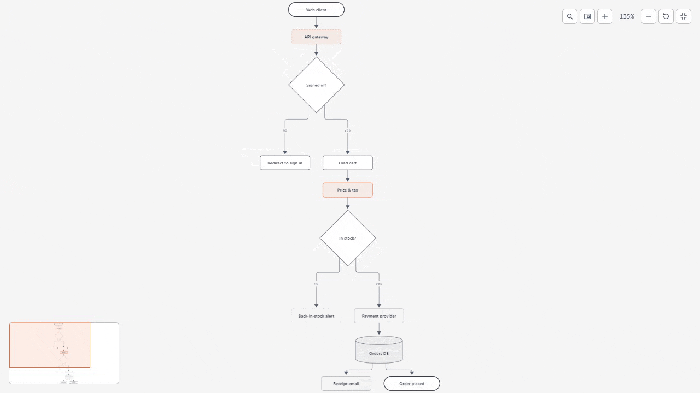
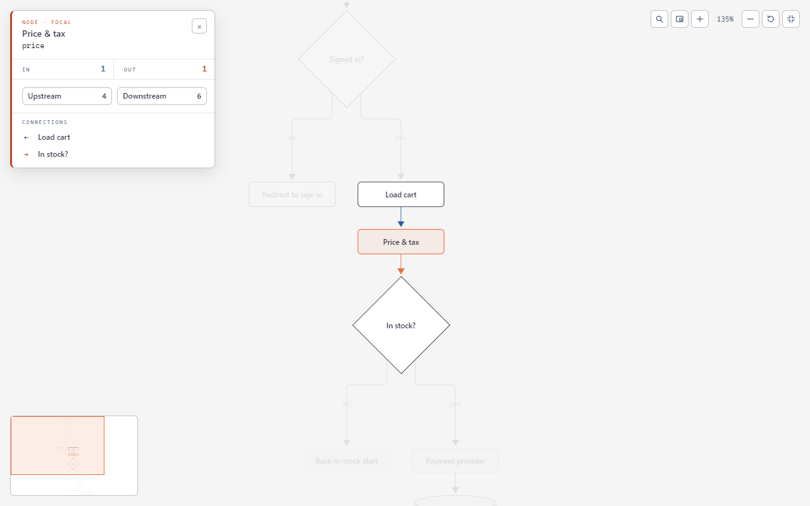
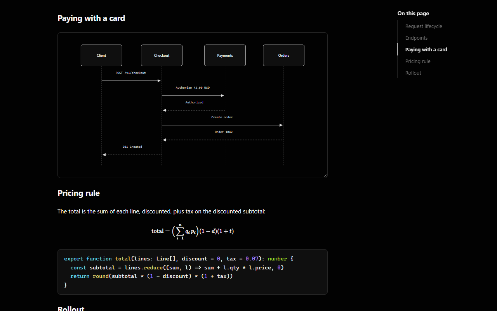
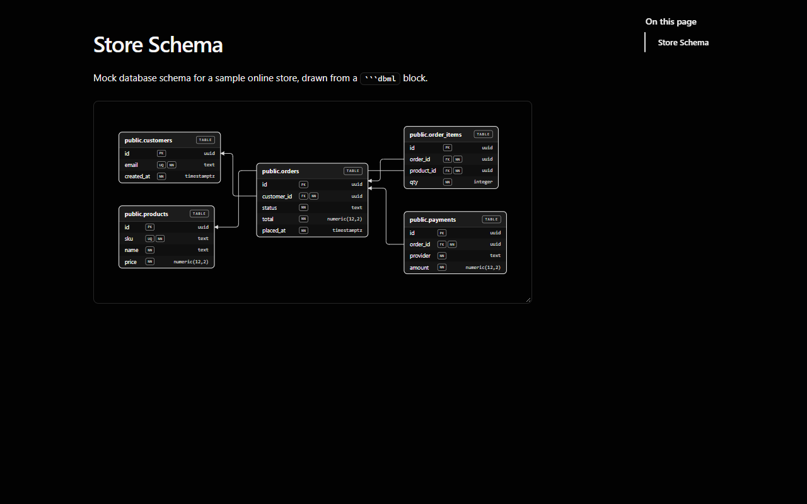
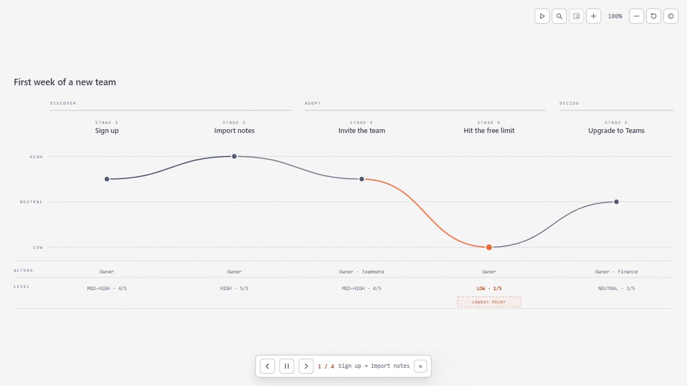
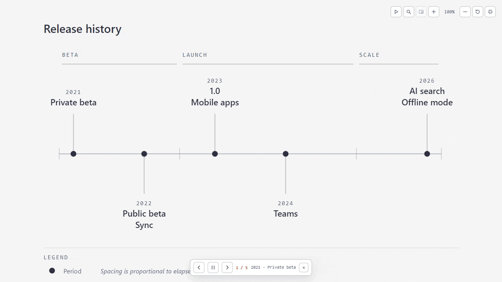
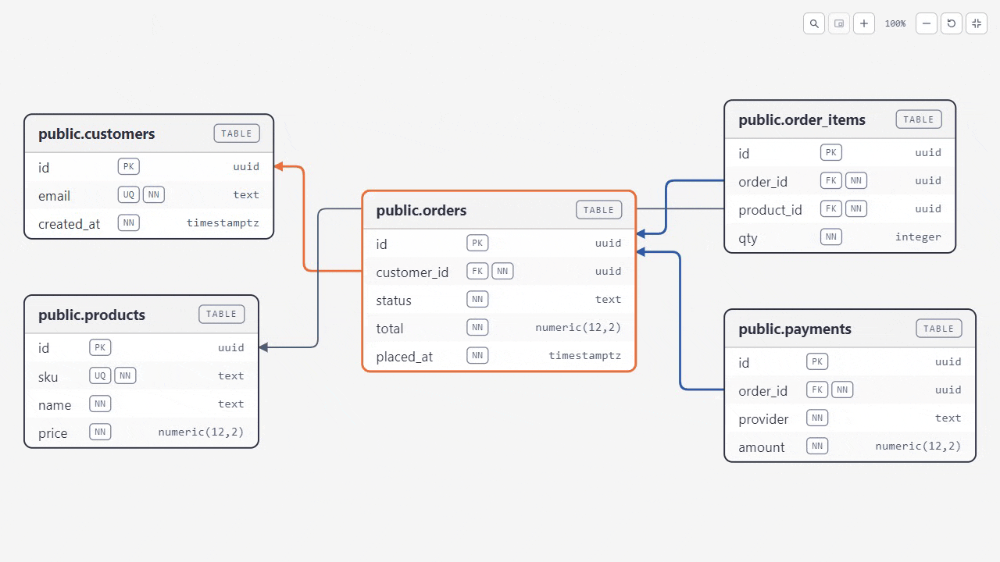
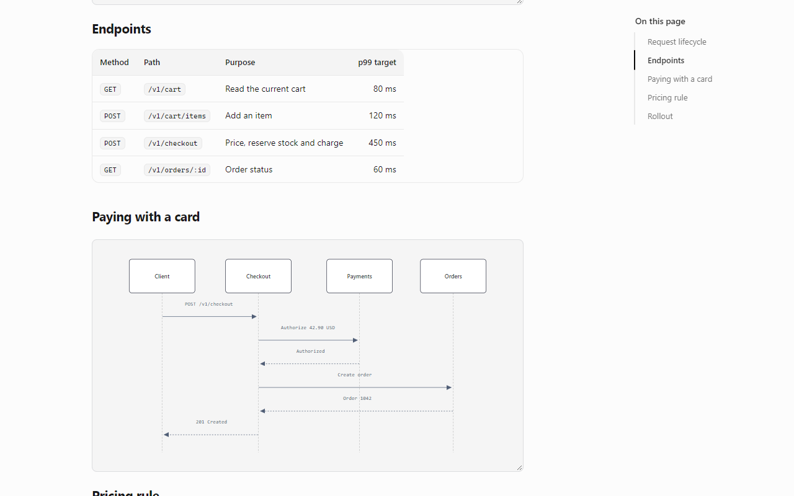
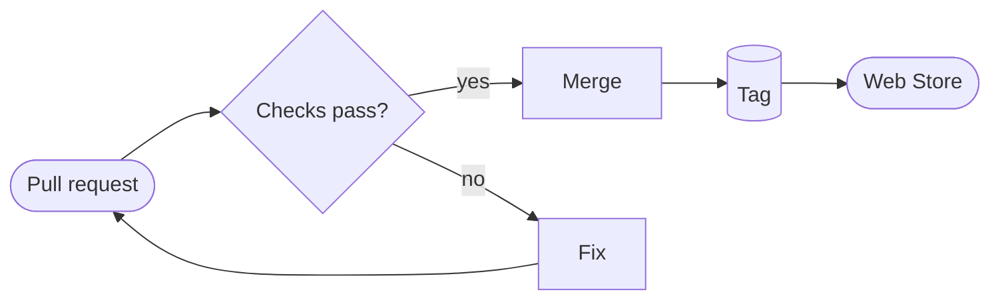

<div align="center">


# Nimbus Markdown

**Mermaid diagram ที่สำรวจได้จริง ในเบราว์เซอร์ของคุณ**

เปิดไฟล์ `.md` ใน Chrome แล้วอ่านเป็นเอกสารสวยตามธีมได้ทันที กด fullscreen ที่ diagram เพื่อซูม ค้นหา node ดูเส้นเชื่อม และเล่นทีละขั้น ไม่ต้องเปิด editor หรืออัปโหลดไฟล์

[](https://chromewebstore.google.com/detail/nimbus-markdown/kbkjbpmegfjbnpkdmlelkemmolegipkk)
[](https://github.com/dvgamerr-app/nimbus-markdown/stargazers)
[](https://github.com/dvgamerr-app/nimbus-markdown/releases)
[](LICENSE)

[เว็บไซต์](https://dvgamerr.app/nimbus-markdown/) · [ติดตั้ง](#ติดตั้งภายในนาทีเดียว) · [คู่มืออ้างอิง](docs/reference.md) · [English](README.md)



<table>
  <tr>
    <td></td>
    <td></td>
    <td></td>
  </tr>
</table>

**⭐ ถ้า Nimbus ช่วยให้อ่านเอกสารง่ายขึ้น ช่วยกด star ให้หน่อย จะได้มี developer คนอื่นเจอโปรเจกต์นี้มากขึ้น**

</div>

## ทำไมต้อง Nimbus

- **Diagram โต้ตอบได้ ไม่ใช่แค่รูปภาพ** เปิด Mermaid diagram แบบ fullscreen เพื่อซูม ค้นหา เปิดดูเส้นเชื่อมของ node และเล่น sequence, journey, timeline ทีละขั้น
- **ทำมาสำหรับเอกสารที่ developer อ่านทุกวัน** README, design note, architecture และไฟล์ Markdown ที่ AI coding agent เขียนให้ เปิดจากเครื่องได้เลย
- **ไฟล์อยู่ในเครื่องคุณ** render ในเบราว์เซอร์ ไฟล์ในเครื่องเปิดสวิตช์ครั้งเดียว ส่วนเว็บไซต์ใช้ได้เฉพาะที่คุณอนุญาต ดู[นโยบายความเป็นส่วนตัว](PRIVACY.md)
- **ฟรีและ open source** สัญญาอนุญาต MIT เป็น fork ที่ดูแลต่อจาก Markdown Viewer ของ Simeon Velichkov

## ฟีเจอร์

| | ฟีเจอร์ | ได้อะไร |
| :-: | :- | :- |
| 🔍 | **Fullscreen diagram viewer** | ซูม เลื่อน ค้นหา node (`/`) แผนที่ภาพรวม (`M`) เส้นเข้าสีฟ้า เส้นออกสีส้ม |
| ▶️ | **เล่นทีละขั้น** | Sequence, state, journey และ timeline เล่นทีละขั้นได้ (`P`) |
| 🧭 | **Diagram ที่วาดใหม่** | Journey, timeline, gantt, pie, quadrant, git graph, C4, mindmap และ requirement ในสไตล์เดียวกัน |
| 🗄️ | **DBML schema** | บล็อก ` ```dbml ` กลายเป็นการ์ดตาราง พร้อมป้าย key และเส้น foreign key |
| 🎨 | **30+ ธีม** | Nimbus สว่างและมืด, GitHub, ธีม cleanrmd และ CSS ของคุณเอง |
| 🧮 | **MathJax** | สูตรแบบ inline `$…$` และ display `$$…$$` |
| 💻 | **Syntax highlighting** | Prism สำหรับ code block และมุมมอง Markdown ดิบที่ไฮไลต์ |
| 📑 | **สารบัญ** | แถบด้านข้างที่ตามตำแหน่งที่อ่าน |
| 🔄 | **Auto reload** | Preview อัปเดตเมื่อบันทึกไฟล์ในเครื่อง |
| ✅ | **GitHub Flavored Markdown** | ตาราง task list footnote emoji และอื่น ๆ ผ่าน markdown-it |

<details>
<summary><b>ภาพและ animation เพิ่มเติม</b></summary>

| เล่น Journey | เล่น Timeline |
| :-: | :-: |
|  |  |
| **DBML hover และ popup** | **ตาราง โค้ด และสูตร** |
|  |  |

ทุกภาพ render จากเอกสารตัวอย่างใน [docs/showcase](docs/showcase/)

</details>

## ติดตั้งภายในนาทีเดียว

1. ติดตั้ง **[Nimbus Markdown จาก Chrome Web Store](https://chromewebstore.google.com/detail/nimbus-markdown/kbkjbpmegfjbnpkdmlelkemmolegipkk)** ใช้กับเบราว์เซอร์ Chromium อย่าง Edge และ Brave ได้ด้วย
2. สำหรับไฟล์ในเครื่อง: เปิด `chrome://extensions` กด **Details** ของ Nimbus Markdown แล้วเปิด **Allow access to file URLs**
3. ลากไฟล์ `.md` เข้าเบราว์เซอร์

สำหรับ Markdown บนเว็บไซต์ กดไอคอน extension เปิด **Advanced Options** แล้วเพิ่มเว็บ เช่น `https://raw.githubusercontent.com` รายละเอียดอยู่ใน [Manage Origins](docs/reference.md#manage-origins)

## ลองใช้

บันทึกเป็น `flow.md` เปิดใน Chrome แล้วกดปุ่ม fullscreen ที่ diagram:

````markdown
# Release flow


````

หรือเปิดตัวอย่างสำเร็จรูปใน [docs/showcase](docs/showcase/) และ diagram ทุกชนิดใน [docs/mermaid.md](docs/mermaid.md)

## เอกสาร

- [คู่มืออ้างอิง](docs/reference.md) (ภาษาอังกฤษ): ธีม ตัวเลือก compiler และ content, origins, การติดตั้งเอง
- [ตัวอย่าง Mermaid](docs/mermaid.md) และ [ตัวอย่าง DBML](docs/dbml.md)
- [หมายเหตุ Firefox](firefox.md), [นโยบายความเป็นส่วนตัว](PRIVACY.md), [changelog](CHANGELOG.md)

## พัฒนา

```bash
bun i
bun run build:dist    # build สำหรับ Chrome ที่ dist/nimbus-markdown
bun test              # unit test
```

โหลด `dist/nimbus-markdown` ด้วย **Load unpacked** ที่ `chrome://extensions` (เปิด Developer mode) ใช้ `bun run build:dist:firefox` สำหรับ Firefox

## สนับสนุนโปรเจกต์

- ⭐ [กด star](https://github.com/dvgamerr-app/nimbus-markdown/stargazers) ให้คนอื่นเจอโปรเจกต์มากขึ้น
- 🐛 [แจ้งบั๊กหรือขอฟีเจอร์](https://github.com/dvgamerr-app/nimbus-markdown/issues)
- 💬 รีวิวบน [Chrome Web Store](https://chromewebstore.google.com/detail/nimbus-markdown/kbkjbpmegfjbnpkdmlelkemmolegipkk)

## License

[MIT](LICENSE) พัฒนาต่อจาก [Markdown Viewer](https://github.com/simov/markdown-viewer) ของ Simeon Velichkov
