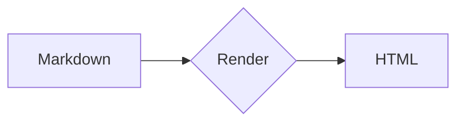

# Markdown Syntax Test

Test page for every syntax Nimbus Markdown can render: CommonMark, GFM, and the optional markdown-it plugins (abbr, attrs, deflist, footnote, ins, mark, sub, sup, task lists), plus MathJax and emoji.

[TOC]

## 1. Headings

# H1 heading
## H2 heading
### H3 heading
#### H4 heading
##### H5 heading
###### H6 heading

Setext H1
=========

Setext H2
---------

## 2. Emphasis

*italic* and _italic_

**bold** and __bold__

***bold italic*** and ___bold italic___

~~strikethrough~~ and ~single tilde~

==highlighted (mark)== , ++inserted (ins)++

H~2~O (subscript) and E = mc^2^ (superscript)

Escape: \*not italic\* \_not\_ \# \[ \] \` \\

Entities: &copy; &amp; &lt;tag&gt; &#35; &#x1F600; &hearts;

Typographer: (c) (r) (tm) +- ... -- --- "double quotes" 'single quotes'

## 3. Line breaks

Soft break
on the next line (breaks: true turns it into a br).

Hard break with two spaces  
next line.

Hard break with backslash\
next line.

## 4. Lists

### Unordered

- Item one
- Item two
  - Nested a
  - Nested b
    - Deep nested
* Star bullet
+ Plus bullet

### Ordered

1. First
2. Second
   1. Sub first
   2. Sub second
3. Third

5. Starts at five
6. Six

1) Paren style
2) Paren style

### Loose list

- Paragraph one

- Paragraph two

  Continuation paragraph inside item.

### Task list

- [x] Done task
- [ ] Open task
  - [x] Nested done
  - [ ] Nested open

### Mixed content

1. Step with code:

   ```bash
   bun run build
   ```

2. Step with quote:

   > Quoted inside a list

## 5. Links

Inline: [Nimbus](https://github.com "title here")

Reference: [full ref][ref1], [collapsed][], [shortcut]

[ref1]: https://example.com "Example"
[collapsed]: https://example.org
[shortcut]: https://example.net

Autolink: <https://example.com> and <hello@example.com>

Linkify (bare): https://example.com/path?x=1 and www.example.com

Anchor: [jump to tables](#8-tables)

Relative: [mermaid test](./mermaid.md)

## 6. Images


[](https://example.com)

Reference image: ![ref image][img1]

[img1]: ../icons/default/128x128.png "Ref title"

Attrs on image: {width=64 height=64}

## 7. Code

Inline `code`, with backticks: `` a ` b ``.

Indented code:

    function indented() {
      return true
    }

Fenced, no language:

```
plain text
no highlight
```

Tilde fence:

~~~
tilde fenced
~~~

JavaScript:

```js
const greet = (name) => `Hello, ${name}!`
console.log(greet('Nimbus'))
```

TypeScript:

```ts
interface User { id: number; name: string }
const u: User = { id: 1, name: 'Ann' }
```

Python:

```python
def fib(n: int) -> int:
    return n if n < 2 else fib(n - 1) + fib(n - 2)
```

Bash:

```bash
#!/usr/bin/env bash
for i in {1..3}; do echo "line $i"; done
```

JSON:

```json
{ "name": "nimbus", "version": 6.0, "tags": ["md", "mermaid"], "ok": true, "none": null }
```

YAML:

```yaml
key: value
list:
  - a
  - b
```

HTML, CSS, SQL, Go, Rust, diff:

```html
<div class="box"><p>Hello</p></div>
```

```css
.box { color: #eb6c36; display: grid; }
```

```sql
SELECT id, name FROM users WHERE active = TRUE ORDER BY name LIMIT 10;
```

```go
func main() { fmt.Println("hi") }
```

```rust
fn main() { println!("hi"); }
```

```diff
- removed line
+ added line
  context line
```

Nested fence (four backticks):

````markdown
```js
inner
```
````

## 8. Tables

| Left | Center | Right |
| :--- | :----: | ----: |
| a    |   b    |     c |
| **bold** | `code` | [link](https://example.com) |
| pipe \| escaped | ~~strike~~ | 1,000 |

Minimal table:

a | b
--|--
1 | 2

## 9. Blockquotes

> Single line quote

> Multi-line quote
continues lazily
>
> Second paragraph
>
> > Nested quote
> > > Triple nested

> **Note**
> Quote with *formatting*, `code`, and a list:
>
> - one
> - two

## 10. Horizontal rules

---

***

___

- - -

## 11. Footnotes

Here is a footnote reference[^1] and another one[^note] and an inline one^[Inline footnote text.].

[^1]: The first footnote.
[^note]: A named footnote with multiple paragraphs.

    Indented continuation paragraph.

## 12. Definition list

Term 1
: Definition for term 1

Term 2
: Definition A for term 2
: Definition B for term 2

Markdown
: A lightweight markup language
: Created by John Gruber

## 13. Abbreviations

The HTML specification is maintained by the W3C. Use CSS and JS together.

*[HTML]: Hyper Text Markup Language
*[W3C]: World Wide Web Consortium
*[CSS]: Cascading Style Sheets

## 14. Attributes (markdown-it-attrs)

A paragraph with class and id {.red #custom-id}

[Button link](https://example.com){.button target=_blank}

**Strong with class**{.big}

```js {.line-numbers}
console.log('attrs on a fence')
```

## 15. Math (MathJax)

Inline: $E = mc^2$ and $\sum_{i=1}^{n} i = \frac{n(n+1)}{2}$

Block:

$$
\int_{-\infty}^{\infty} e^{-x^2}\,dx = \sqrt{\pi}
$$

$$
\begin{aligned}
\nabla \cdot \vec{E} &= \frac{\rho}{\varepsilon_0} \\
\nabla \times \vec{B} &= \mu_0 \vec{J} + \mu_0\varepsilon_0 \frac{\partial \vec{E}}{\partial t}
\end{aligned}
$$

Matrix: $\begin{pmatrix} a & b \\ c & d \end{pmatrix}$

## 16. Emoji

:smile: :heart: :rocket: :tada: :+1: :-1: :warning: :bulb: :fire: :star:

## 17. Raw HTML

<details>
<summary>Click to expand</summary>

Hidden **markdown** content inside details.

</details>

<kbd>Ctrl</kbd> + <kbd>C</kbd>, <mark>mark tag</mark>, <sub>sub</sub>, <sup>sup</sup>, <u>underline</u>, <abbr title="Title text">abbr</abbr>

<div align="center">

**Centered block**

</div>

<!-- HTML comment: should not be visible -->

<table>
  <tr><th>HTML</th><th>Table</th></tr>
  <tr><td>cell 1</td><td>cell 2</td></tr>
</table>

<p style="color:#eb6c36">Inline styled paragraph</p>

## 18. Mermaid (quick check)



See [mermaid.md](./mermaid.md) for every diagram type.

## 19. Misc edge cases

Unicode / CJK / Thai: สวัสดีชาวโลก 你好，世界 こんにちは 안녕하세요 🌏

Long unbroken text: aaaaaaaaaaaaaaaaaaaaaaaaaaaaaaaaaaaaaaaaaaaaaaaaaaaaaaaaaaaaaaaaaaaaaaaaaaaaaaaaaaaaaaaaaaaaaaaaaaaaaaaaaaaa

Heading with `code`, *emphasis* and [link](https://example.com)
------------------------------------------------------------------

# Heading with trailing hashes ##

Adjacent emphasis: *a**b**c* and snake_case_word and 2*3*4

Empty link: [empty]() and unresolved reference: [missing][nope]
