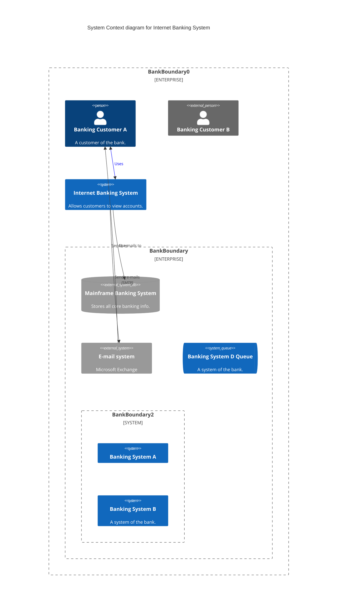
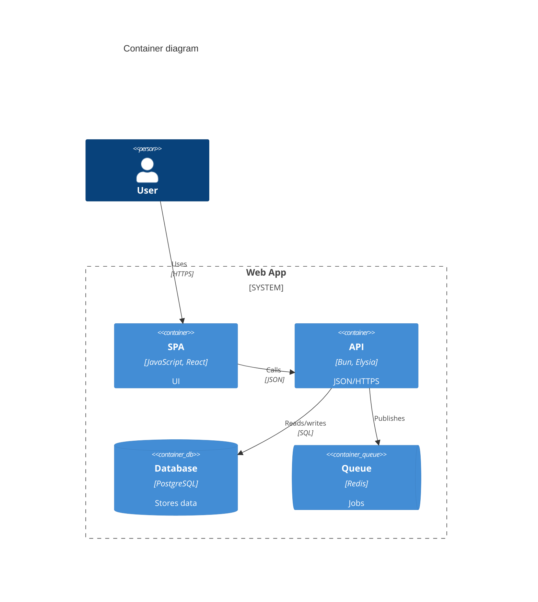
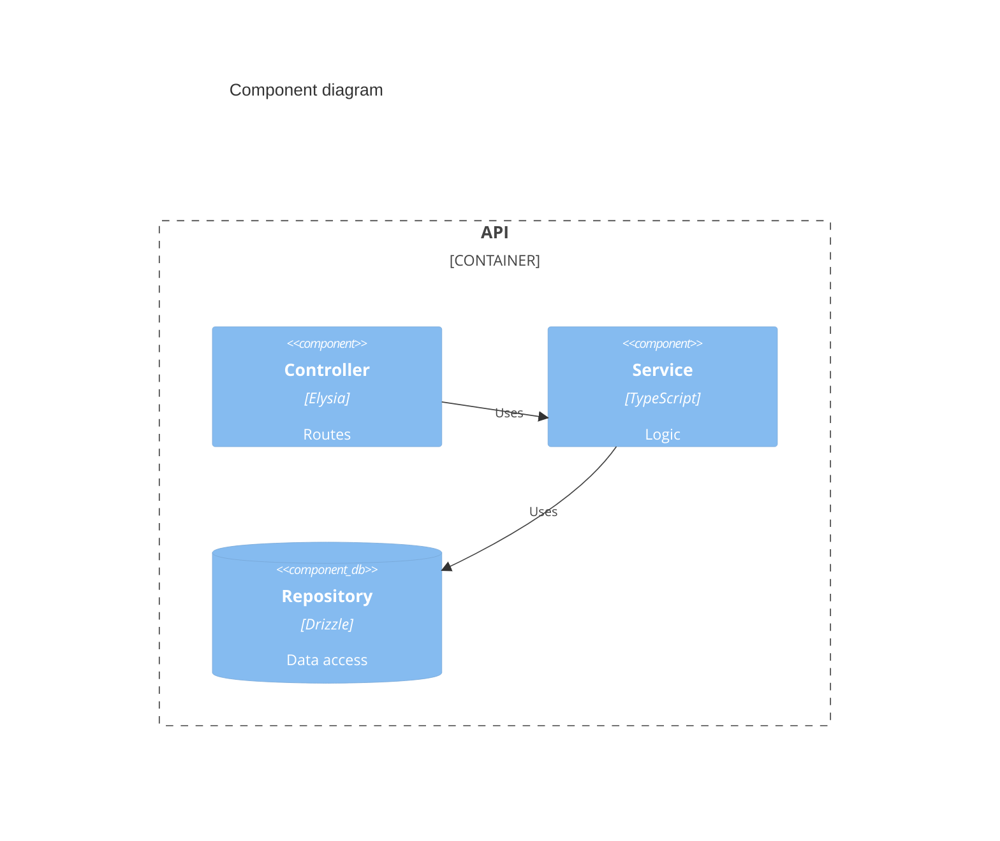
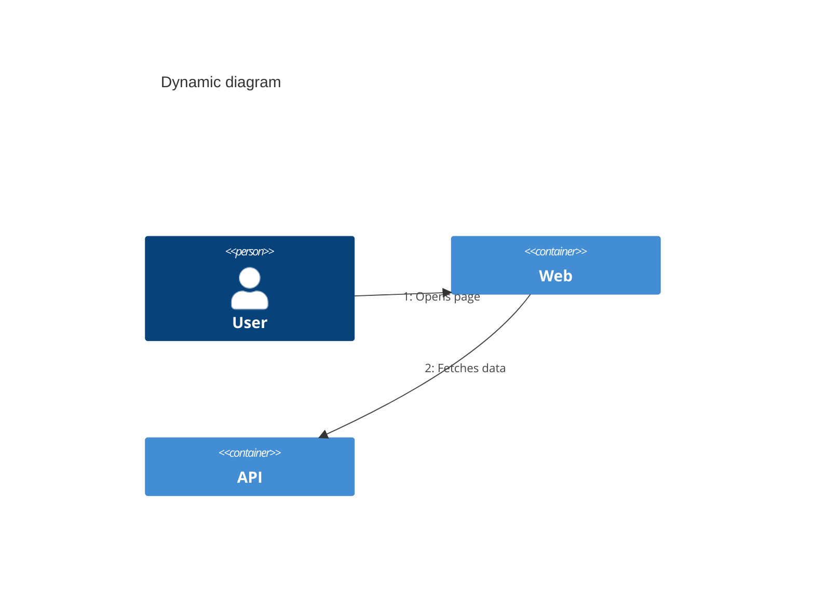

# Mermaid: C4 Diagrams









```mermaid
C4Deployment
  title Deployment diagram
  Deployment_Node(dc, "Data Center", "Kubernetes") {
    Deployment_Node(pod, "Pod", "Docker") {
      Container(api, "API", "Bun", "Service")
    }
  }
  Node(ext, "External", "SaaS")
  Rel(api, ext, "Calls", "HTTPS")
```

[← Back to index](../mermaid.md)
