# Mermaid: Class Diagram

[TOC]

Laid out to the diagram-design UML class rules: at most 7 classes and 8 relationships per diagram, a few members per compartment, and the accent only on the focal class. Syntax coverage is split into small diagrams.

## Relationship vocabulary

All six relationships in one diagram. The focal class is `Animal`. Composition means the part dies with the whole, aggregation means it lives on its own.

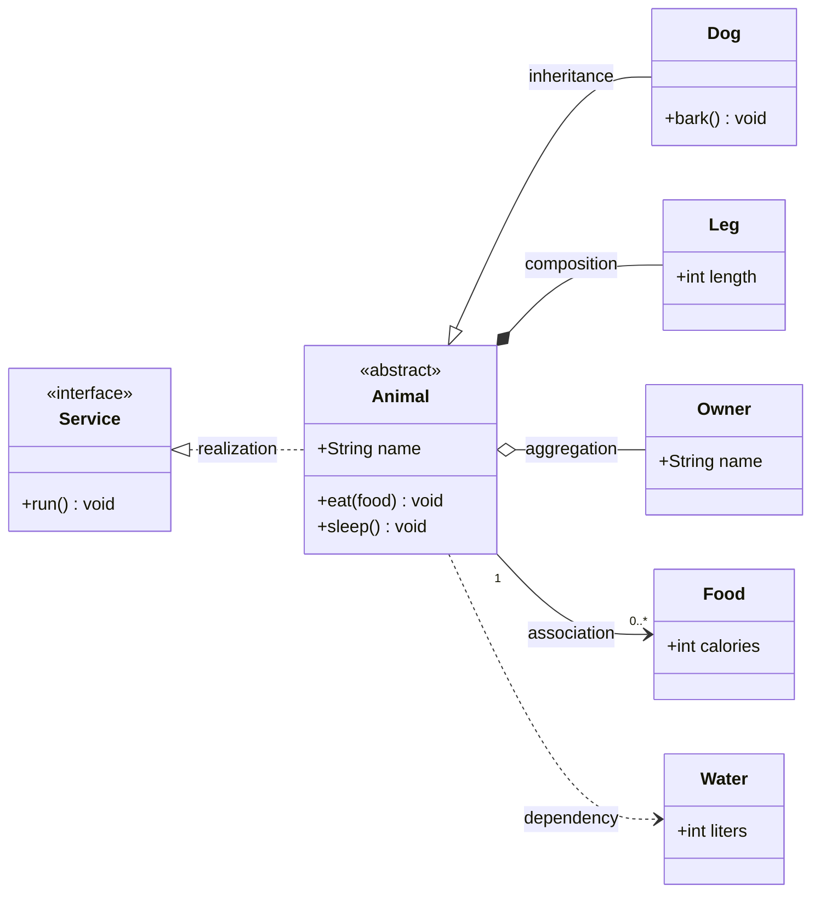

| Relationship | Line | Ending | Syntax |
|---|---|---|---|
| Inheritance (extends) | solid | hollow triangle | `A <|-- B` |
| Realization (implements) | dashed | hollow triangle | `A <|.. B` |
| Composition (owns, cascades) | solid | filled diamond at the owner | `A *-- B` |
| Aggregation (has, independent) | solid | hollow diamond at the owner | `A o-- B` |
| Association | solid | open arrowhead, multiplicity at both ends | `A "1" --> "0..*" B` |
| Dependency (uses) | dashed | open arrowhead | `A ..> B` |

The focal class gets the tinted name compartment, and its inheritance and realization lines take the accent colour.

## Members and visibility

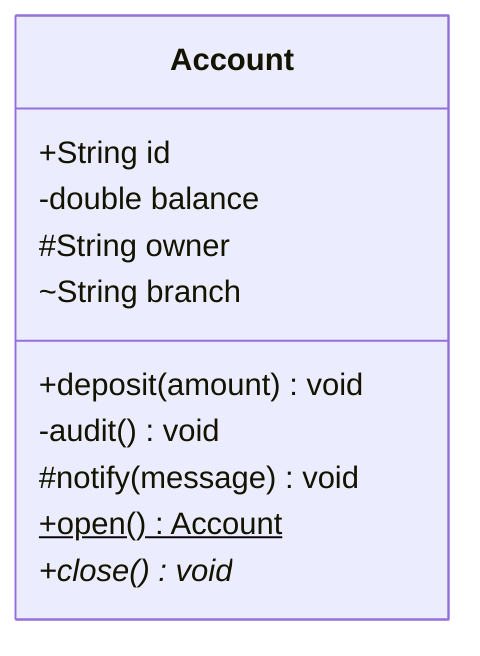

`+` public, `-` private, `#` protected, `~` package. A trailing `$` marks a static member and `*` an abstract one.

## Stereotypes

A stereotype only for the interfaces and abstract classes that need one.

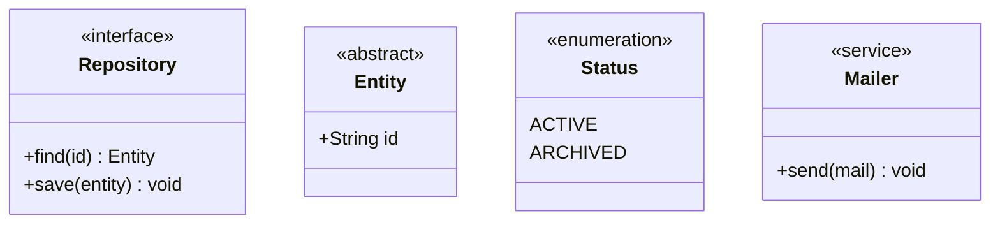

## Generics

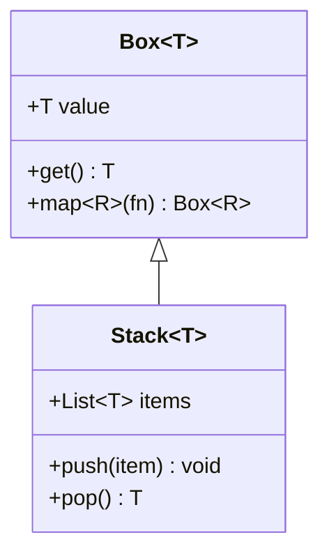

## Multiplicity and labels

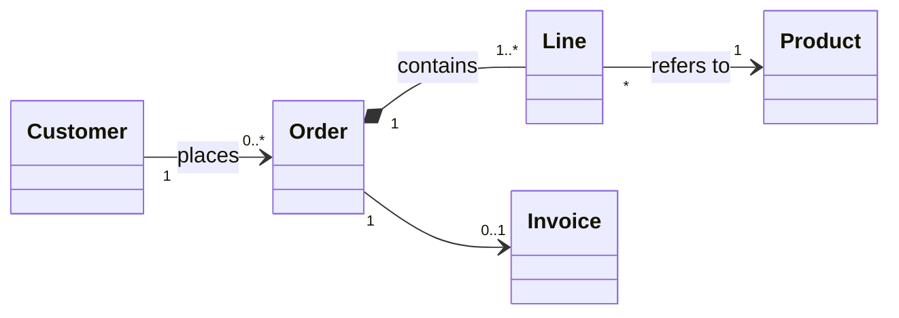

## Relationship kinds, all arrows

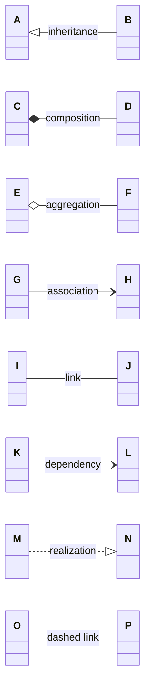

## Lollipop interface

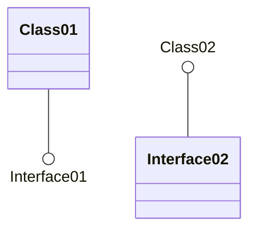

## Direction

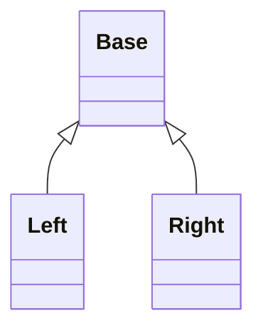

## Notes

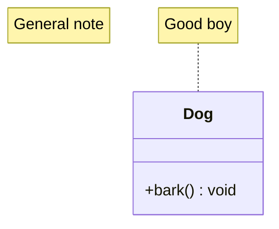

## Namespaces

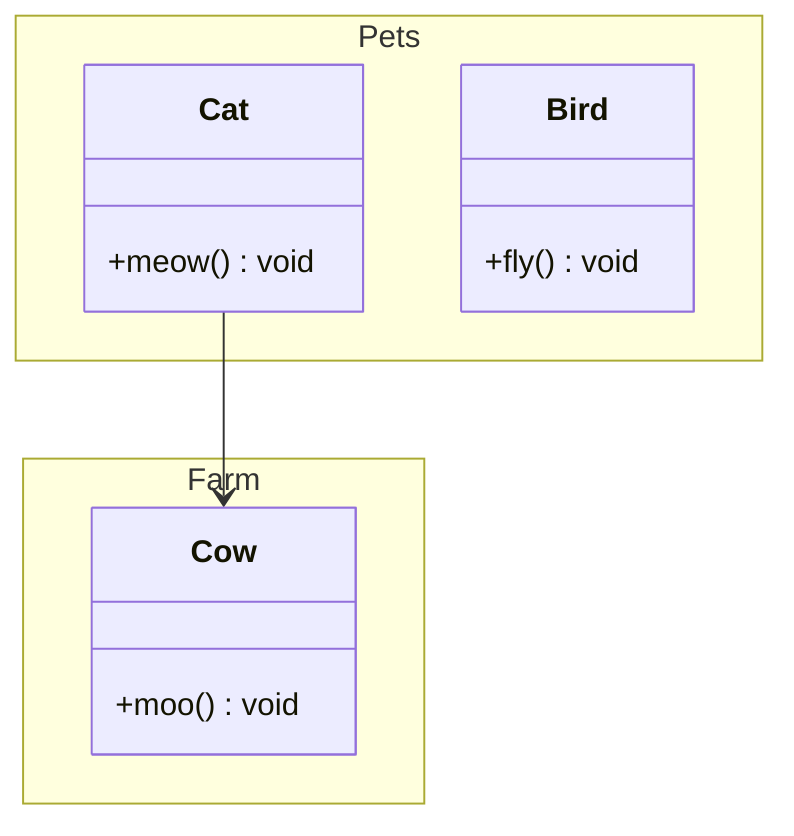

## Interaction

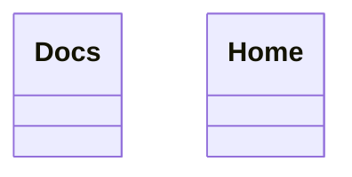

## Styling

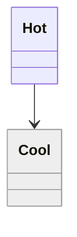

[← Back to index](../mermaid.md)
