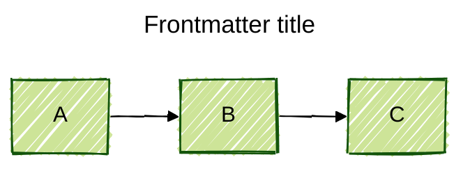
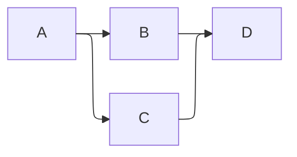
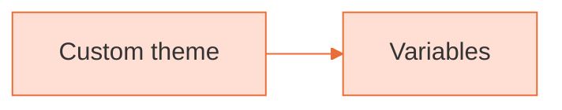
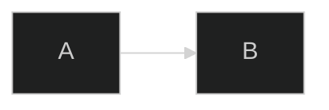
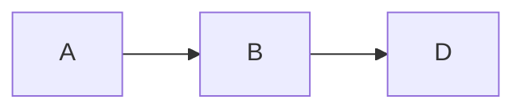
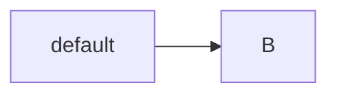
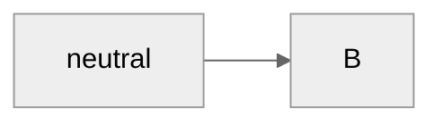
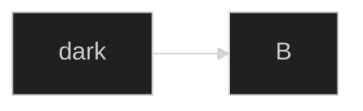
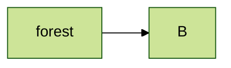
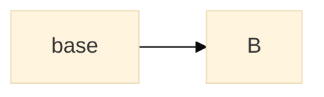

# Mermaid: Configuration, themes and comments

[TOC]

### Frontmatter title and config

### Layout engine (ELK)

### Theme variables (base theme)

### Directive (deprecated but still accepted)

### Comments

### Themes side by side

[← Back to index](../mermaid.md)
