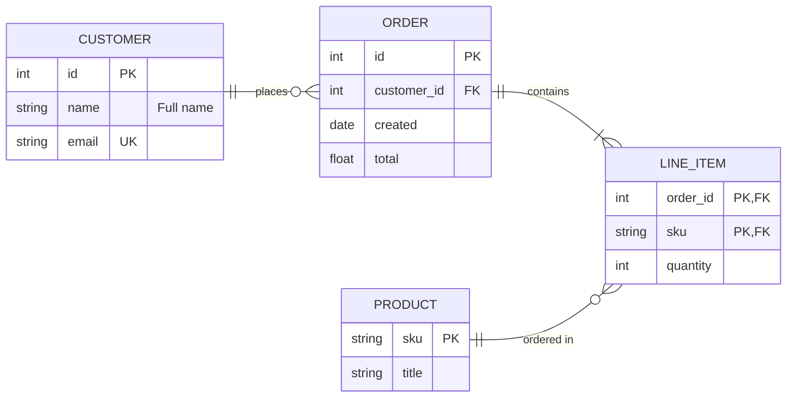
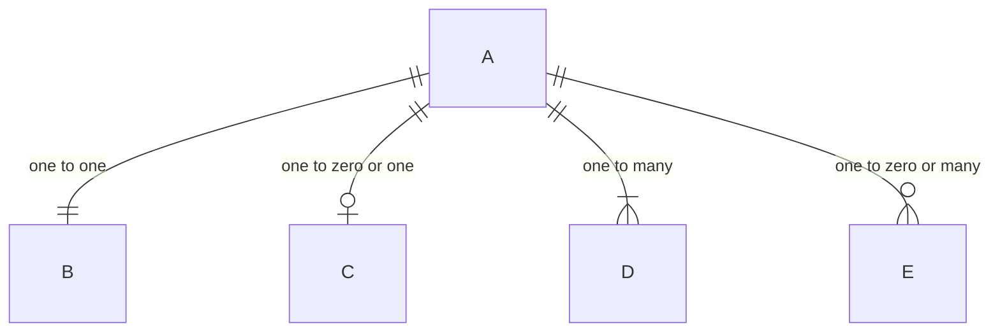
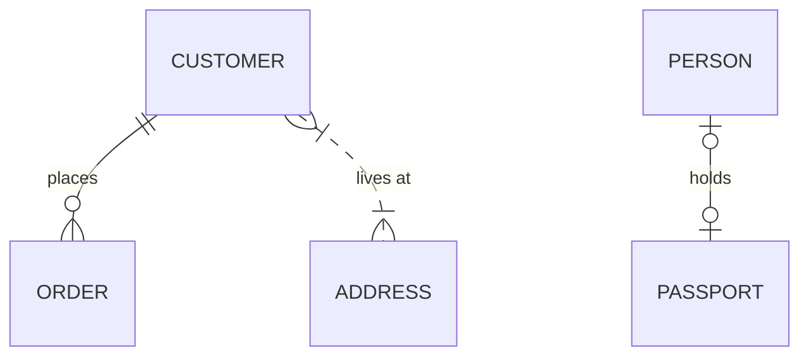
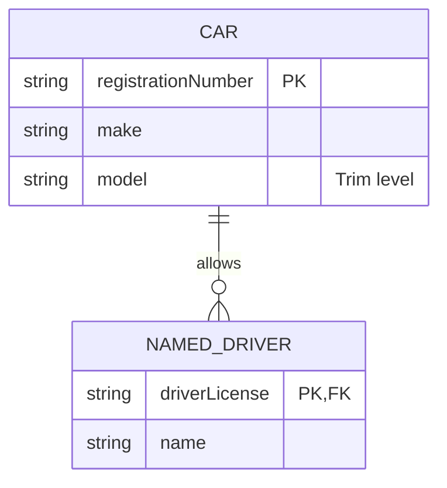
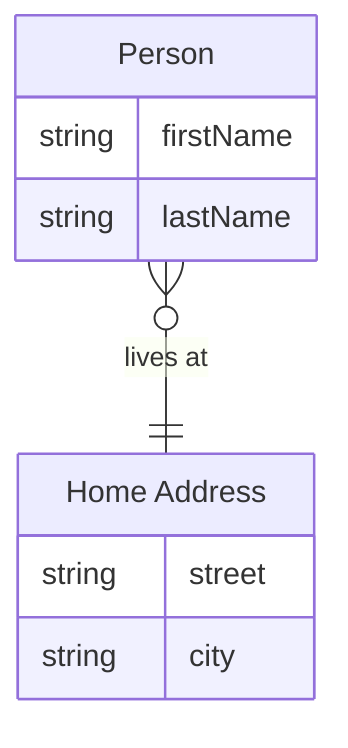

# Mermaid: Entity Relationship Diagram

[TOC]

Laid out to the diagram-design ER rules: an entity is a two-part box with its name on top and its attributes below, key columns marked, and each relationship line carries its cardinality at both ends. Syntax coverage is split into small diagrams so each one stays readable. In fullscreen, click an entity to focus its relationships.

## Reference model

Four entities around one aggregate root. `CUSTOMER:::focal` puts the accent on the root and `LINE_ITEM:::join` draws a join table dashed.

## Cardinality

Each end of a line says how many, drawn as `1` for the one side (`||`, `|o`) and `N` for the many side (`}|`, `}o`).

## Identifying and non-identifying

A solid line identifies: the child cannot exist without the parent. A dashed line does not.

## Attributes and keys

Keys are `PK`, `FK` and `UK`, several can share one attribute, and a quoted string is the attribute comment.

## Aliases

An entity can carry a readable name apart from its id.

[← Back to index](../mermaid.md)
