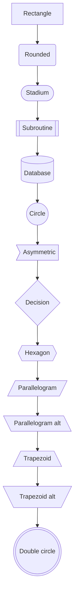
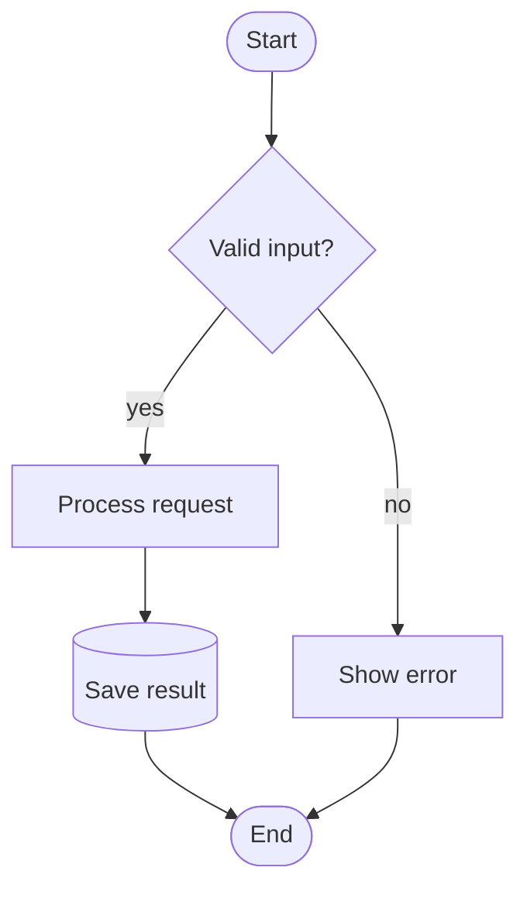
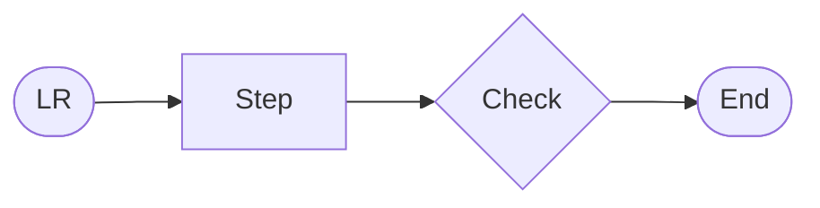
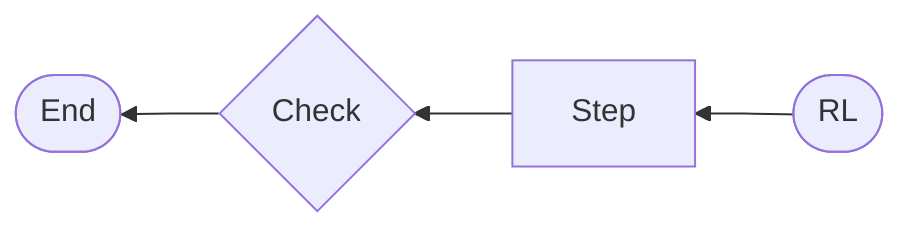
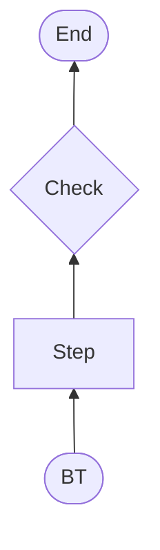
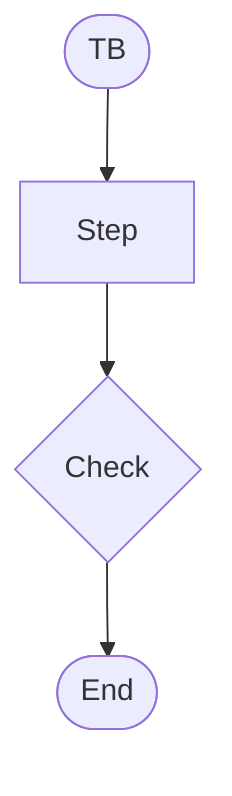
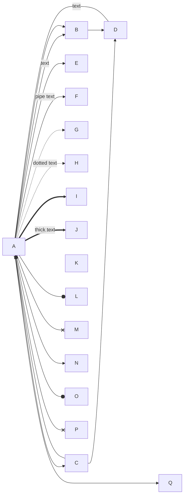
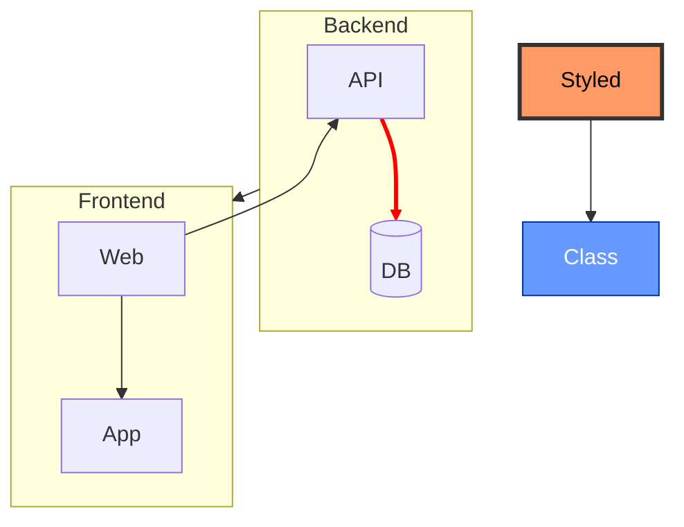
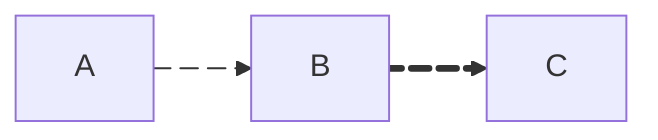

# Mermaid: Flowchart

[TOC]

### Directions and node shapes

All 14 shape syntaxes in one chain. Node kinds use the viewer's diagram-design classes: `focal` (one only), `input`, `store`, `external`, `optional`, `security`.

Shape carries type, as in the flowchart reference: stadium for start and end, rectangle for a step, diamond for a decision, labelled on every exit.

### Directions

### Edge types and labels

### Subgraphs, direction, styling, classes, click

### Markdown strings, unicode, new-style shape syntax

### Edge IDs and animation

[← Back to index](../mermaid.md)
