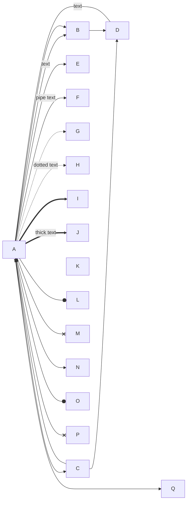
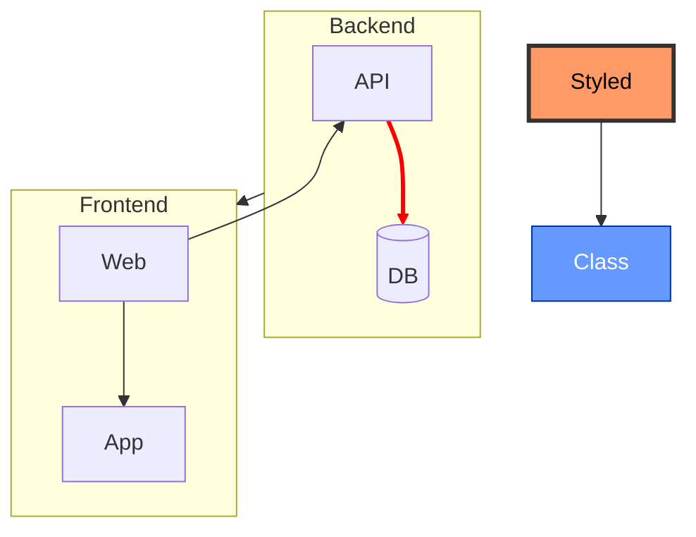
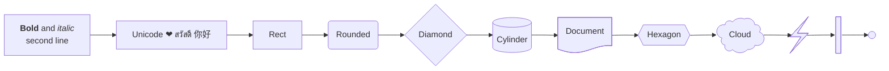
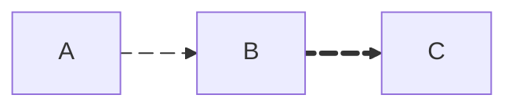

# Mermaid: Flowchart

[TOC]

### Directions and node shapes

### Edge types and labels

### Subgraphs, direction, styling, classes, click

### Markdown strings, unicode, new-style shape syntax

### Edge IDs and animation

[← Back to index](../mermaid.md)
