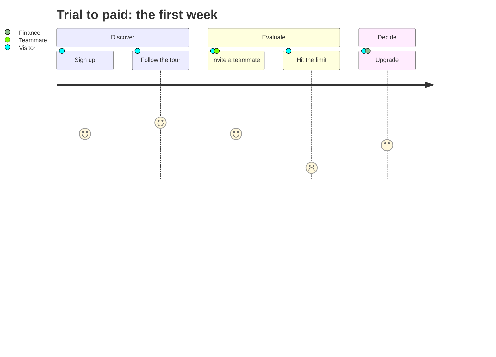
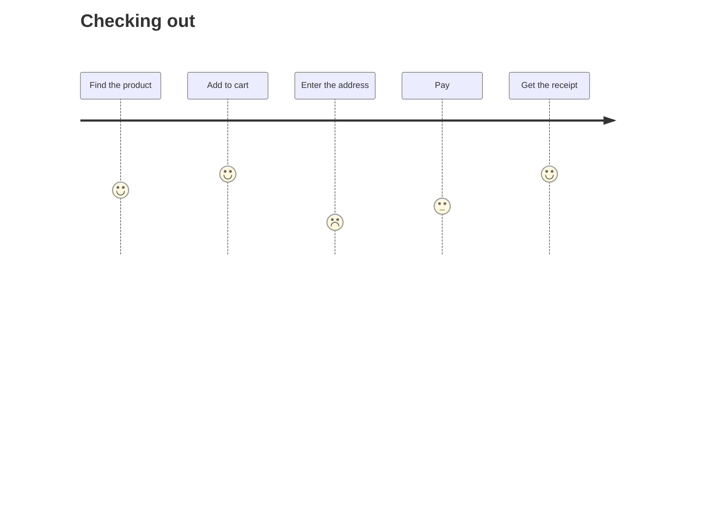
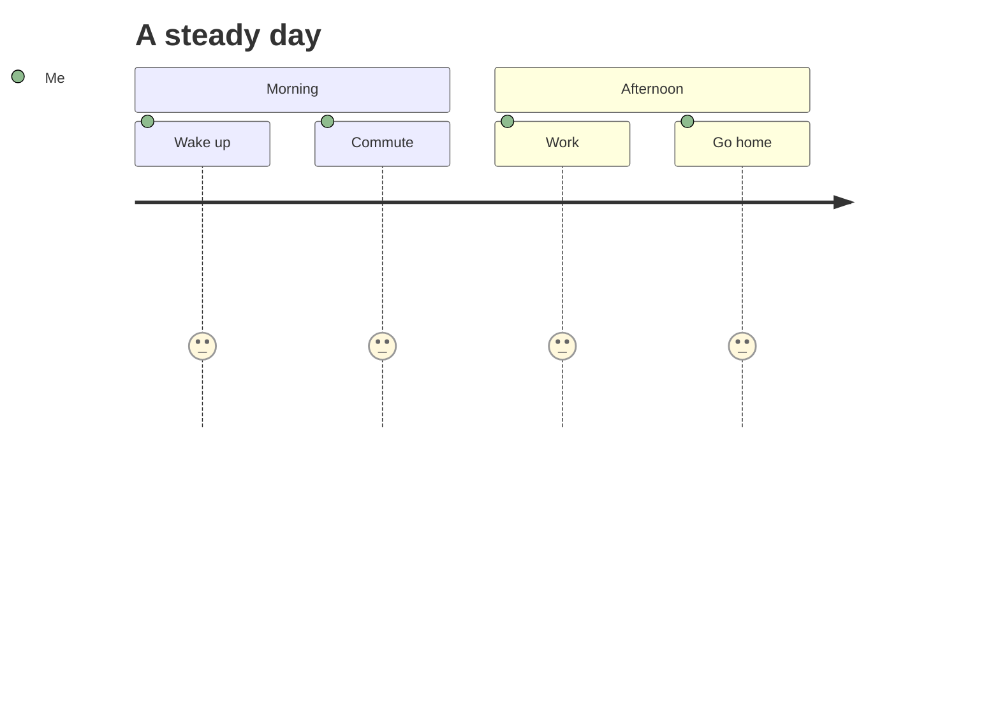
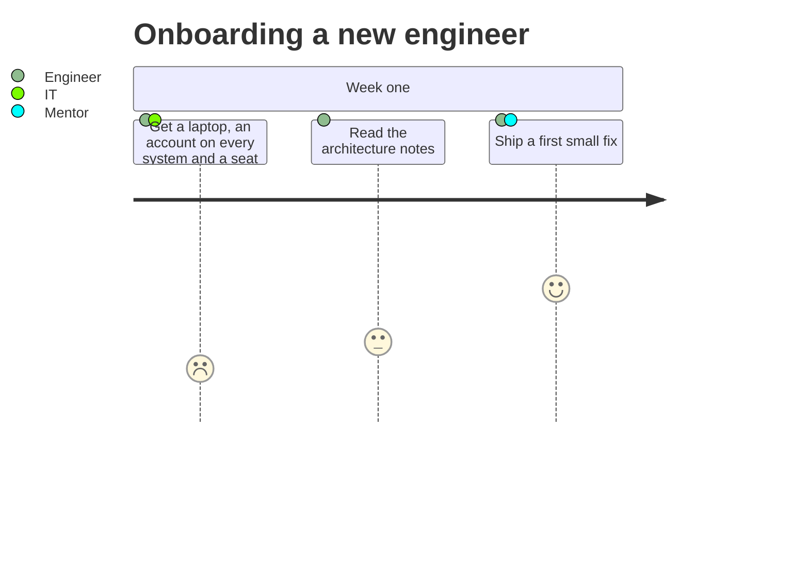
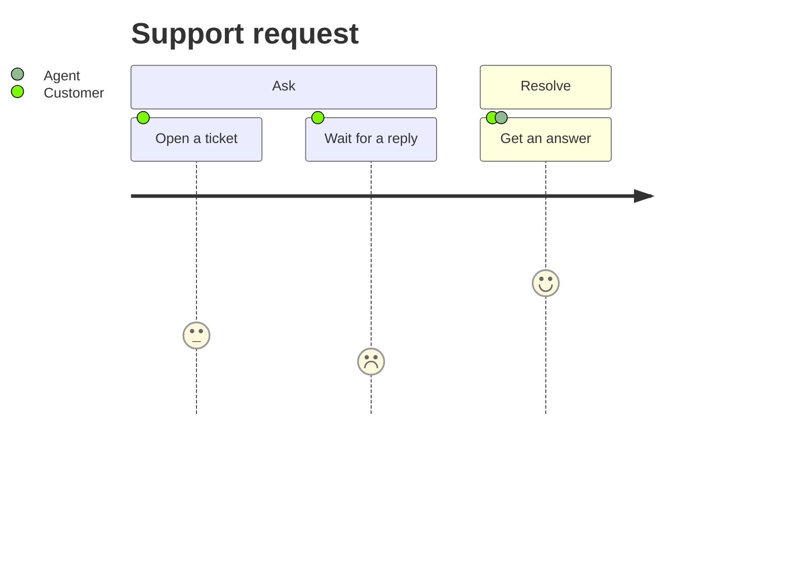

# Mermaid: User Journey

[TOC]

Drawn to the diagram-design journey map rules: one stage per task in a column, a sentiment curve through five named levels (`LOW` to `HIGH`, scores 1 to 5), the lowest stage and the segment leading into it in the accent, and no emoji. A section becomes a label over its stages, the actors of a task sit under its stage. At most 6 stages per journey reads best. In fullscreen, hover a stage to light its curve segments, click it for a popup, and press play to walk the journey from the first stage to the last.

## Reference journey

Five stages for one persona, with the trough at "Hit the limit".

## Without sections or actors

Tasks need only a name and a score. With no section there is no label strip, with no actors there is no actors row.

## One level throughout

When every stage feels the same there is no lowest point to point at, so nothing takes the accent.

## Long names

Stage names wrap to three lines at most and end in an ellipsis after that.

## Comments and accessibility lines

`%%` comments, `accTitle` and `accDescr` are accepted and ignored by the map.

[← Back to index](../mermaid.md)
