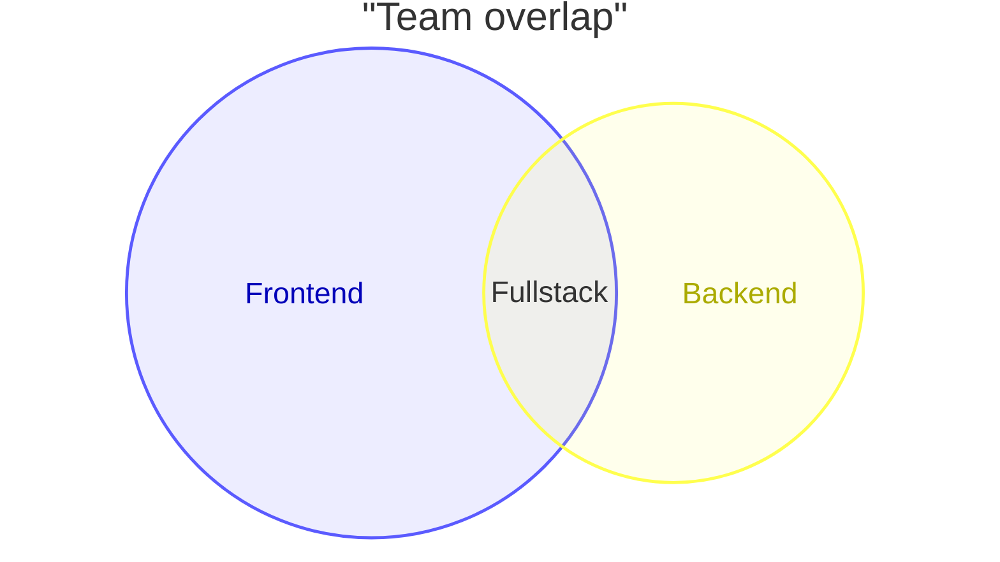
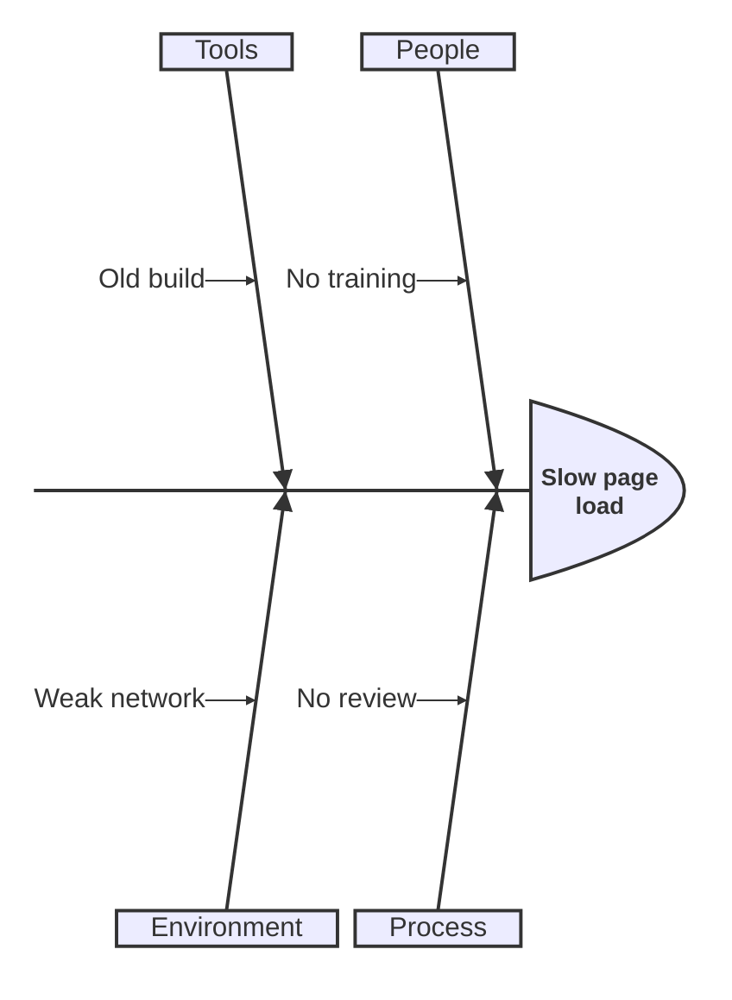
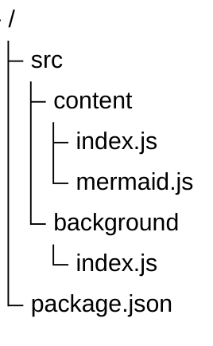

# Mermaid: Additional newer diagrams

[TOC]

Newer types included in 12.2.0. If your bundled build does not recognise one, only that block shows an error.

### Venn



### Ishikawa (fishbone)



### Tree view



### Wardley map

```mermaid
wardley-beta
  title Tea Shop
  size [1100, 800]
  anchor Business [0.95, 0.63]
  component Cup of Tea [0.79, 0.61]
  component Tea [0.63, 0.81]
  component Kettle [0.43, 0.35]
  Business -> Cup of Tea
  Cup of Tea -> Tea
  Cup of Tea -> Kettle
```

[← Back to index](../mermaid.md)
