# Mermaid: Sequence Diagram

[TOC]

Laid out to the diagram-design sequence rules: at most 5 lifelines and 12 messages per diagram, one combined fragment, calls solid and returns dashed. Syntax coverage is split into small diagrams so each one stays readable.

## Reference flow

Five lifelines, ten messages, one `alt` fragment. The happy-path return is the headline message.

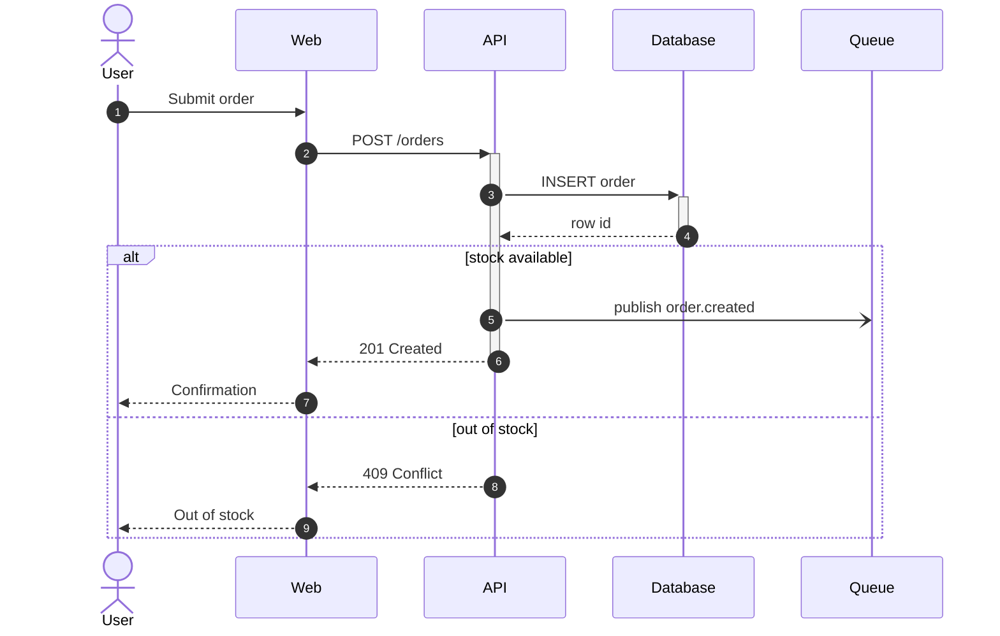

## Message kinds

Call is solid with a filled head, return is dashed with a filled head, async is dashed with an open head.

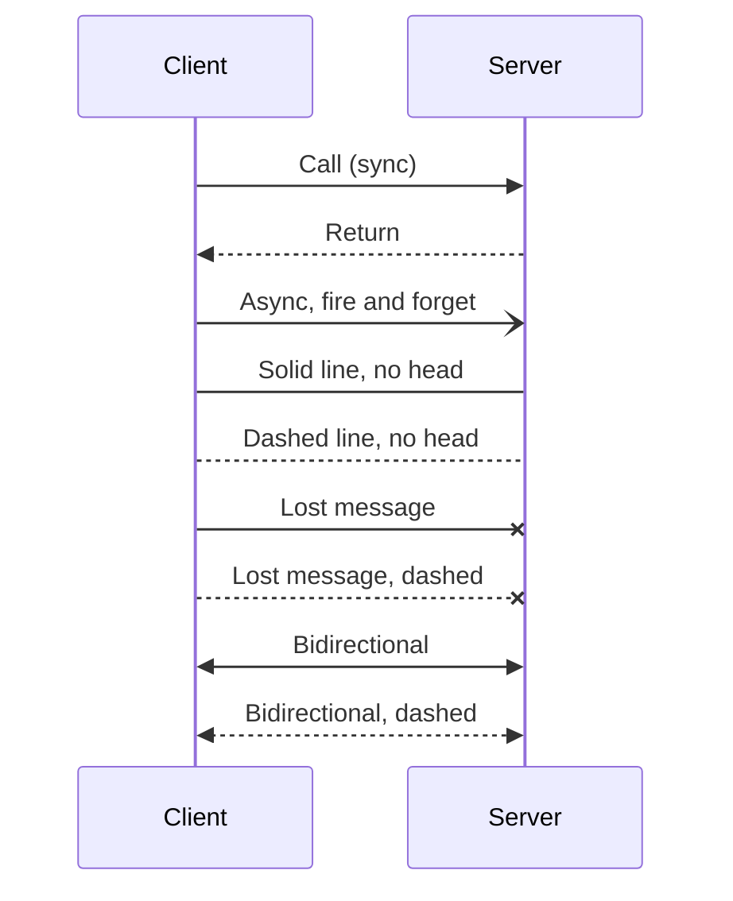

## Participants

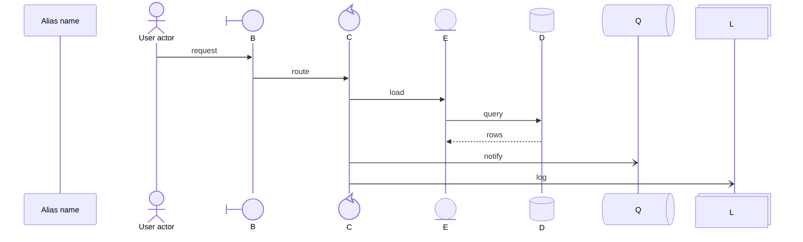

## Activation

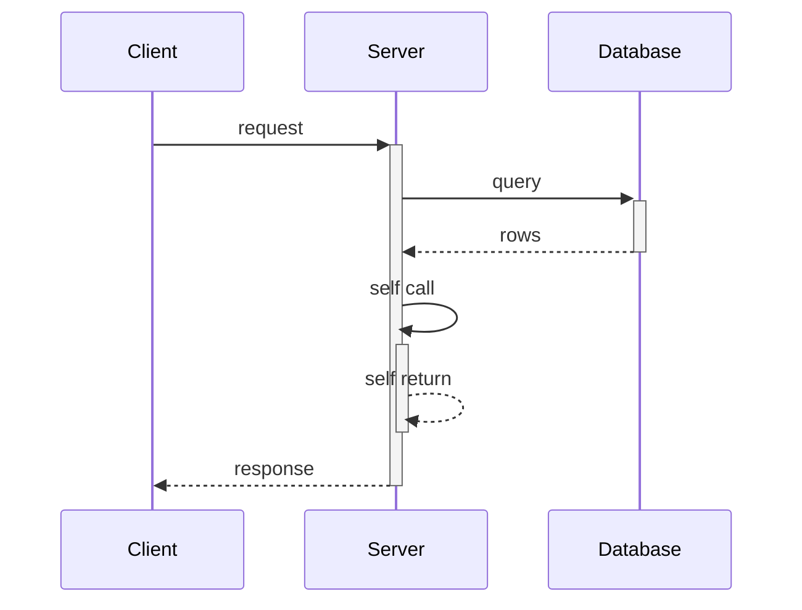

Explicit `activate` and `deactivate`:

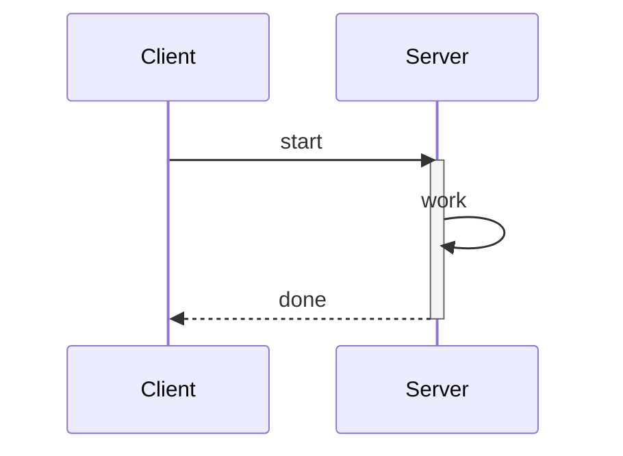

## Notes

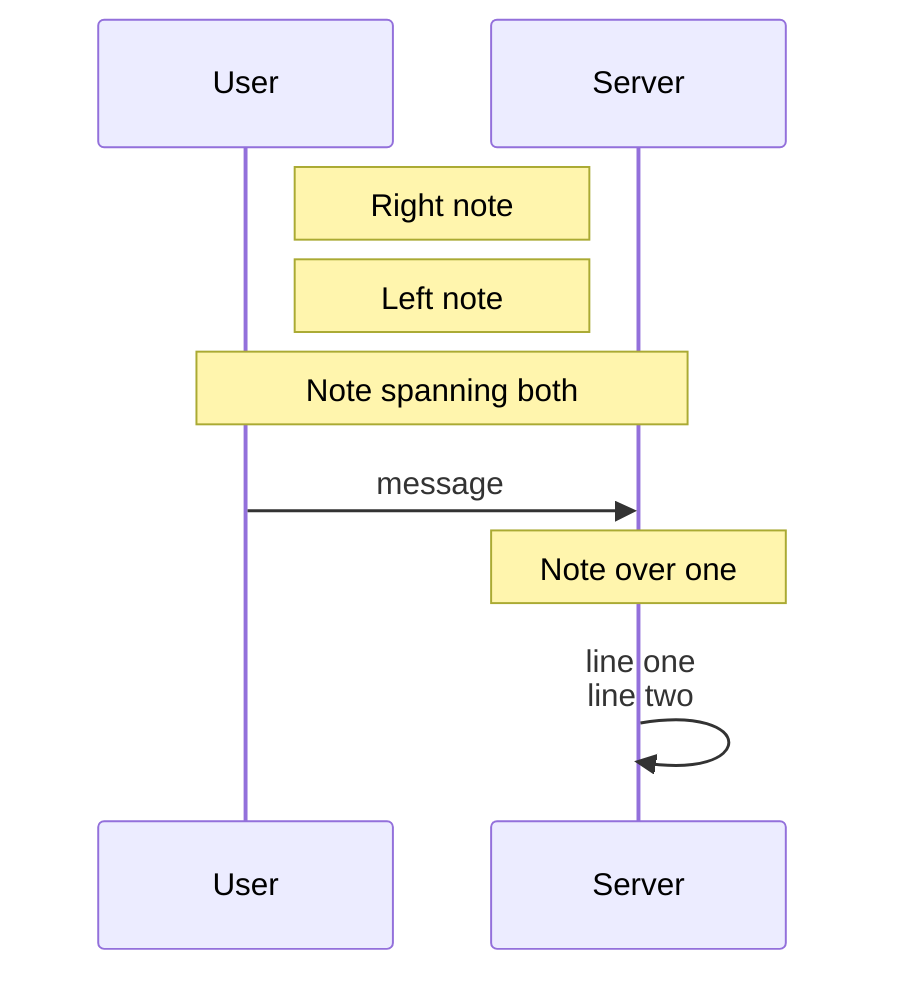

## Combined fragments

### alt and opt

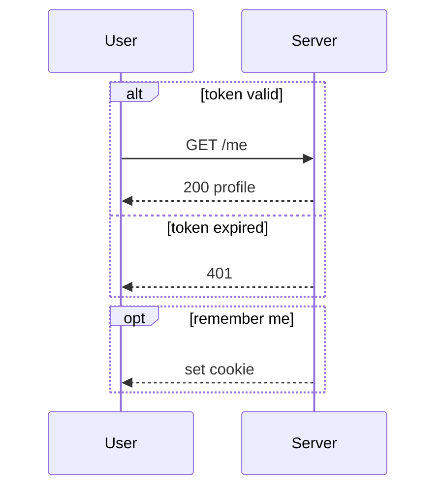

### loop

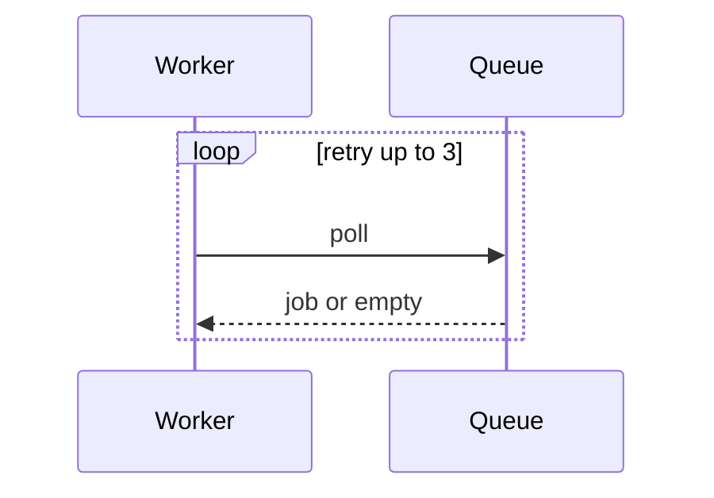

### par, critical and break

Outside the skill's single-fragment budget: kept here only to exercise the syntax.

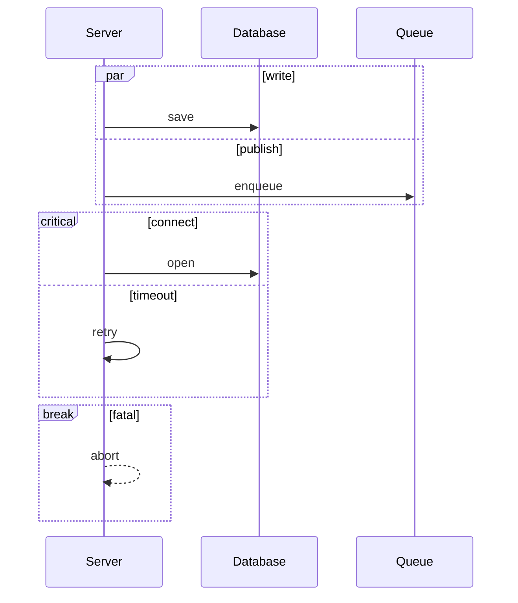

### rect highlight

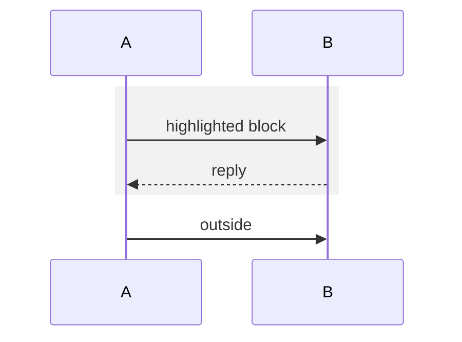

## Create and destroy

A created participant needs a message right after `create`; a destroyed one needs `destroy` right before its last message.

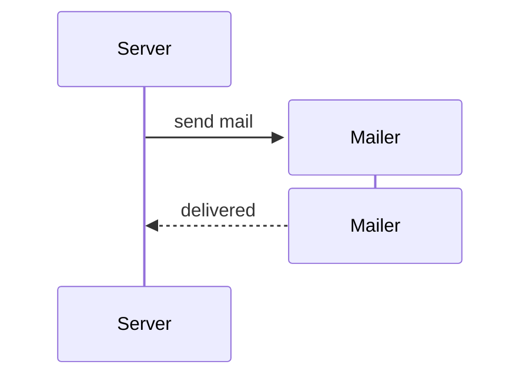

## Grouping with box

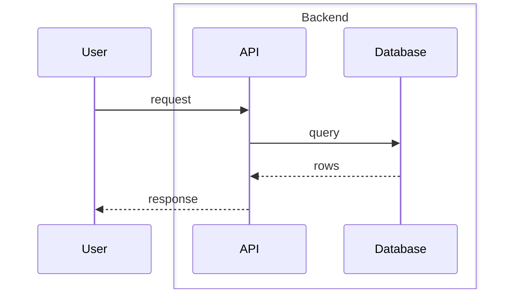

## Links

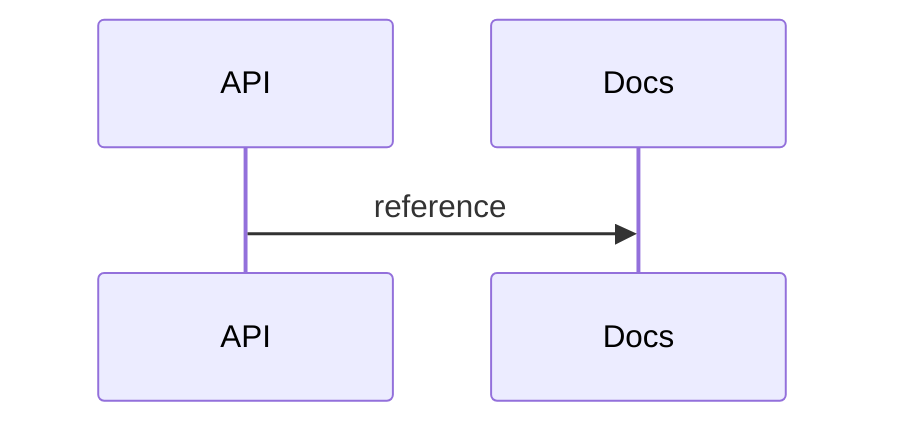

## Title and numbering

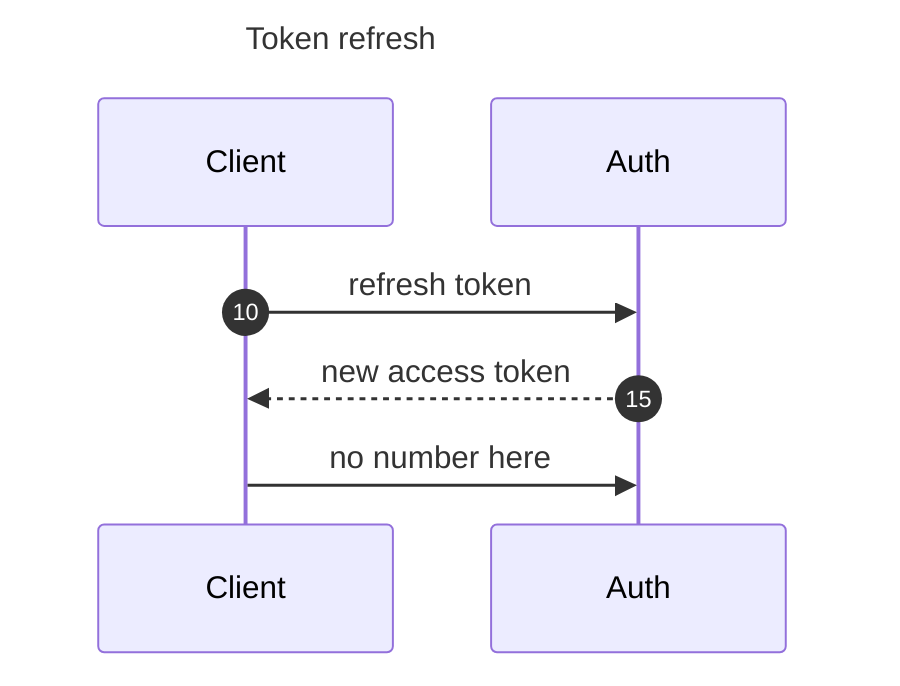

## Text formatting

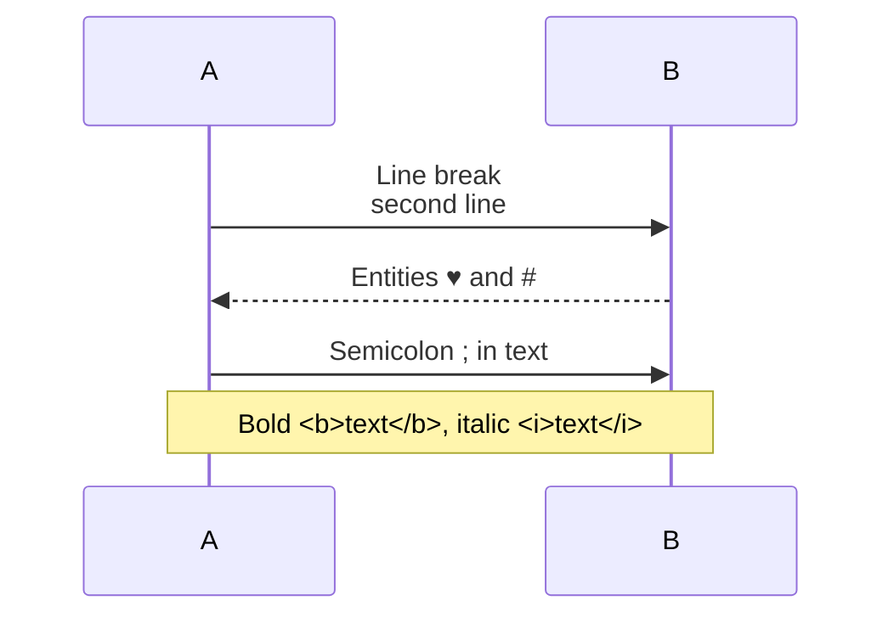
