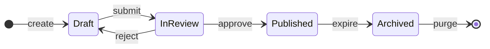
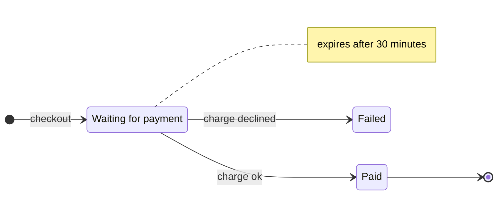
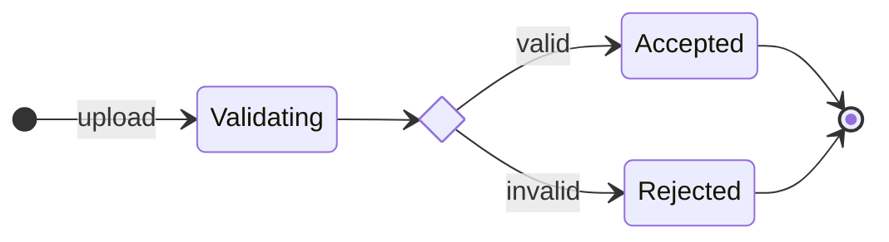
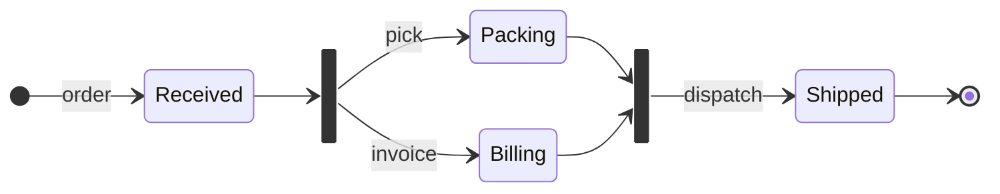
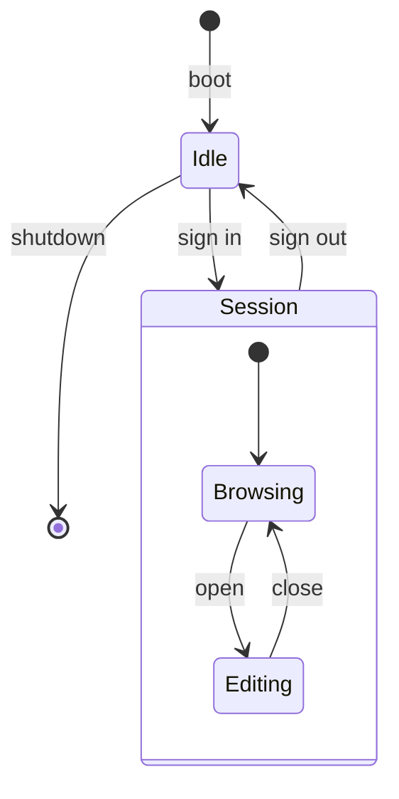
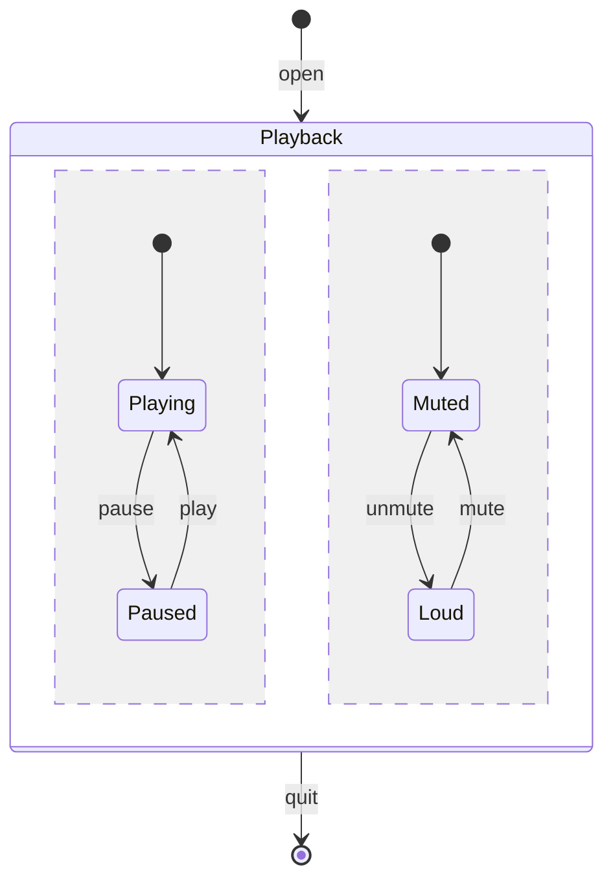
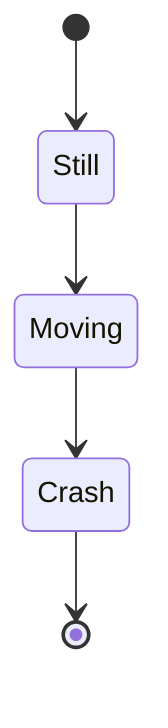

# Mermaid: State Diagram

[TOC]

Laid out to the diagram-design state-machine rules: states are rounded boxes, the start is a filled dot and the end a ringed dot, every transition is labelled with the event that triggers it, and the one state the reader should notice takes the accent. Syntax coverage is split into small diagrams so each one stays readable. In fullscreen, press play to walk the transitions in order.

## Reference flow

Five states, one rejection loop. `class Published focal` puts the accent on the happy-path outcome.

## Names and notes

`state "..." as id` gives a state a readable name, a note pins a remark to the side of a state.

## Choice

A `<<choice>>` diamond routes one event to different outcomes by guard.

## Fork and join

A `<<fork>>` bar starts parallel work and a `<<join>>` bar waits for all of it.

## Composite state

A composite state holds its own small machine. Transitions can enter and leave the box as a whole.

## Concurrent regions

`--` splits a composite state into regions that run side by side.

## Legacy keyword

`stateDiagram` without `-v2` still renders.

[← Back to index](../mermaid.md)
