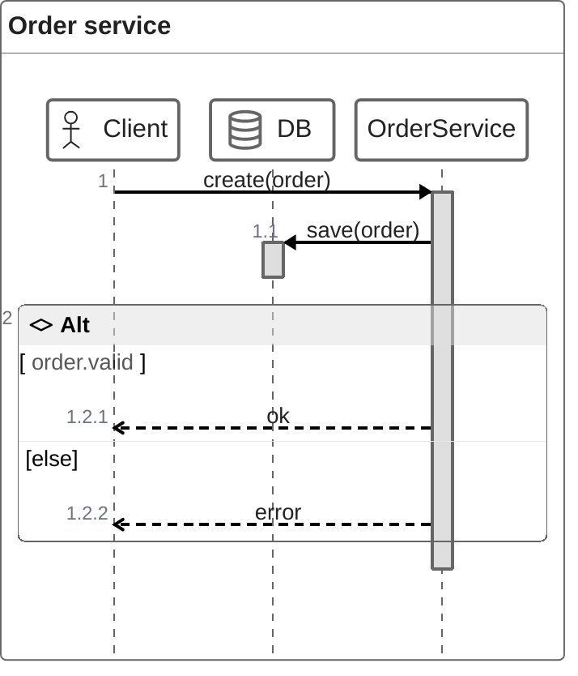

# Mermaid: ZenUML

ZenUML is an external plugin (`@mermaid-js/mermaid-zenuml`) that the bundled Mermaid does not include, so this block is expected to show a parse error in the viewer.

[← Back to index](../mermaid.md)
