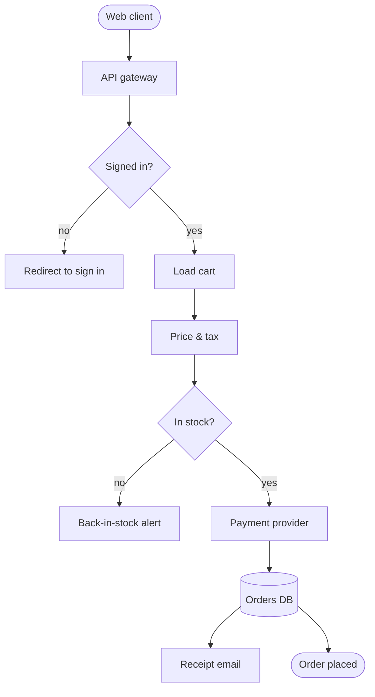
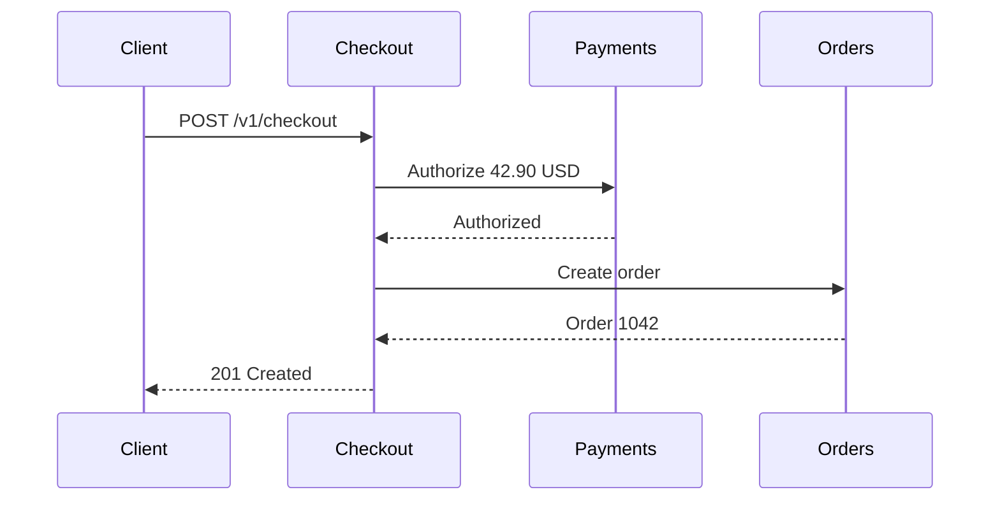

# Checkout Service

Design notes for the checkout service of a sample online store. Every name, number and endpoint on this page is made up, it exists to show how Nimbus Markdown renders a real-looking project document.

## Request lifecycle



## Endpoints

| Method | Path | Purpose | p99 target |
| --- | --- | --- | ---: |
| `GET` | `/v1/cart` | Read the current cart | 80 ms |
| `POST` | `/v1/cart/items` | Add an item | 120 ms |
| `POST` | `/v1/checkout` | Price, reserve stock and charge | 450 ms |
| `GET` | `/v1/orders/:id` | Order status | 60 ms |

## Paying with a card



## Pricing rule

The total is the sum of each line, discounted, plus tax on the discounted subtotal:

$$
\text{total} = \Big(\sum_{i=1}^{n} q_i \, p_i\Big)(1 - d)(1 + t)
$$

```ts
export function total(lines: Line[], discount = 0, tax = 0.07): number {
  const subtotal = lines.reduce((sum, l) => sum + l.qty * l.price, 0)
  return round(subtotal * (1 - discount) * (1 + tax))
}
```

## Rollout

- [x] Price & tax behind a feature flag
- [x] Payments sandbox wired up
- [ ] Back-in-stock alerts
- [ ] Load test at 300 checkouts per second

> **Note** Stock is reserved for 10 minutes. An unpaid reservation is released by a background job.
